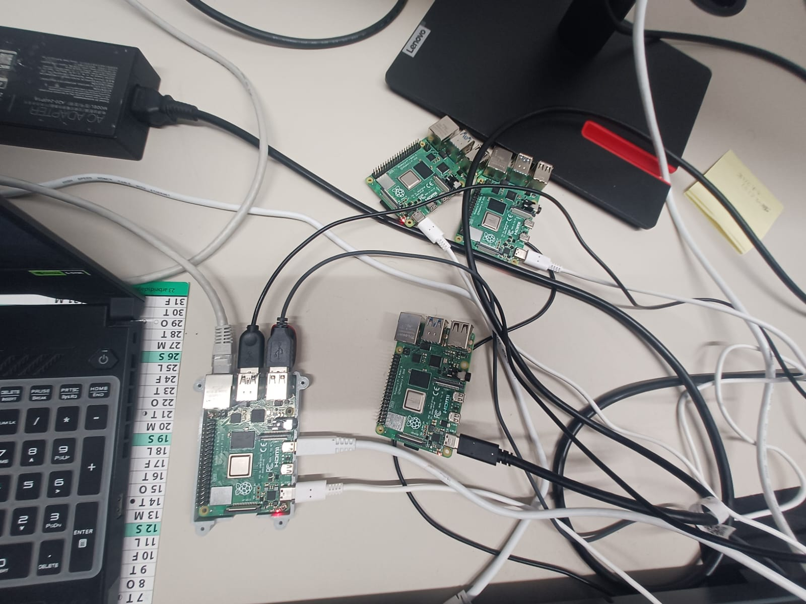
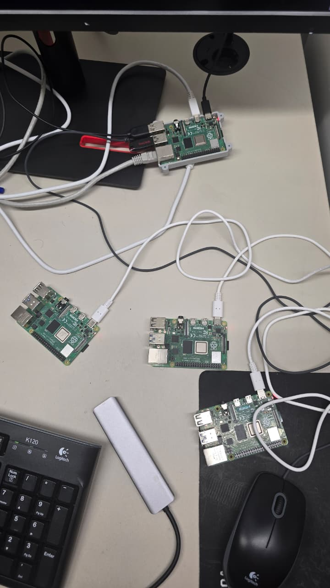
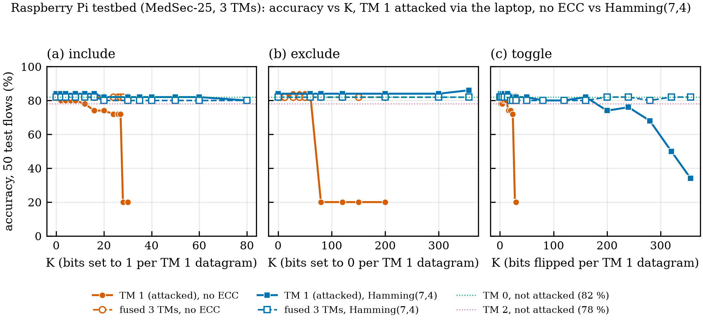
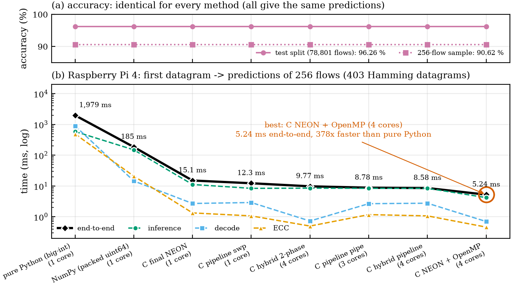

# Tsetlin Machine projects

  
  
   The testbed: the laptop (MITM) connected by Ethernet to one sender Pi (left); four Raspberry Pis and a USB hub (right).

  
  
   Left: accuracy of the attacked TM (orange: no ECC, blue: Hamming(7,4)) as the number of corrupted bits K grows. Right: Pi inference latency per method, from pure Python to NEON + OpenMP.

| Project | What it is |
|---|---|
| [tm-ids-rpi-testbed](tm-ids-rpi-testbed/) | Distributed Tsetlin Machine intrusion detection on a Raspberry Pi testbed. Three sender Pis, one central Pi, and a laptop that acts as a man-in-the-middle and corrupts one Pi's packets; Hamming(7,4) protection; NEON/OpenMP inference. |
| [compression-ecc-experiments](compression-ecc-experiments/) | Compression and error-correcting-code experiments on the TM rule files. |

The code in both projects was written by an AI assistant under my direction; each README states what is verified and what is still unconfirmed.
