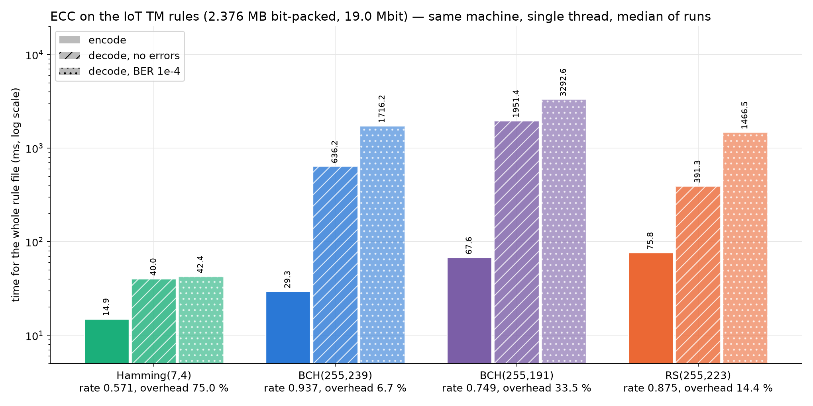
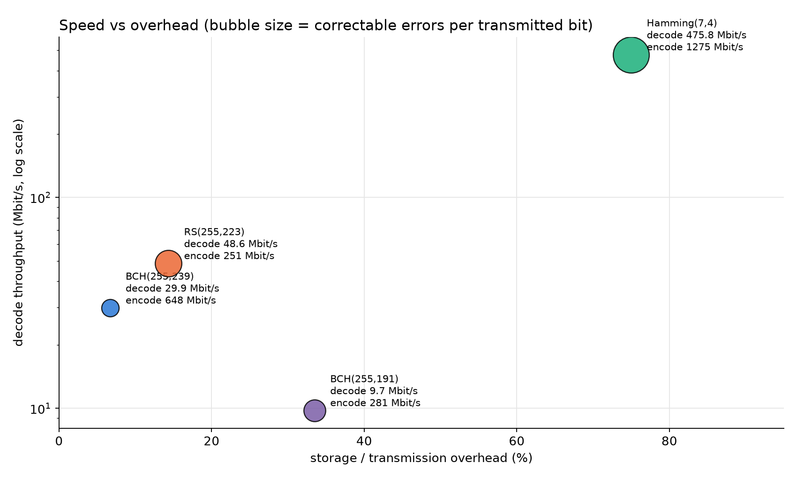
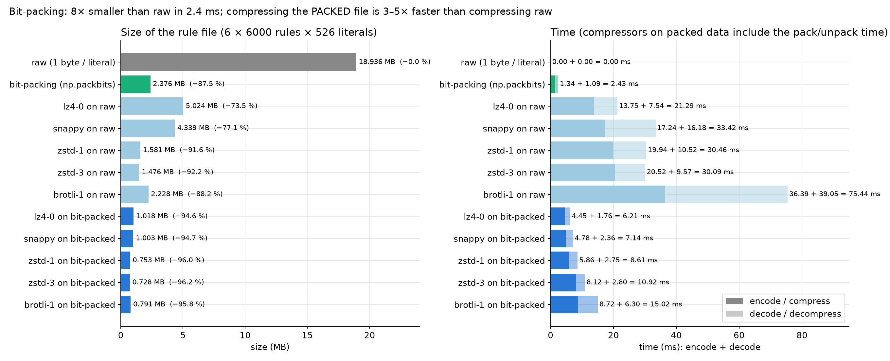
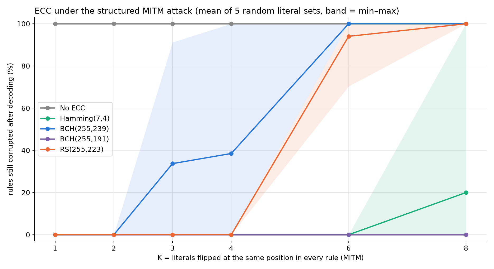
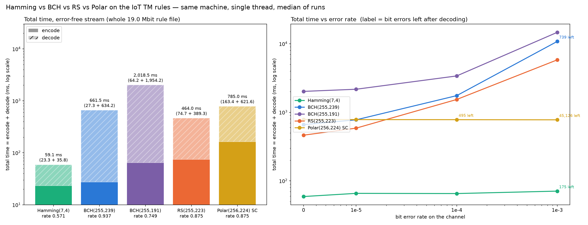
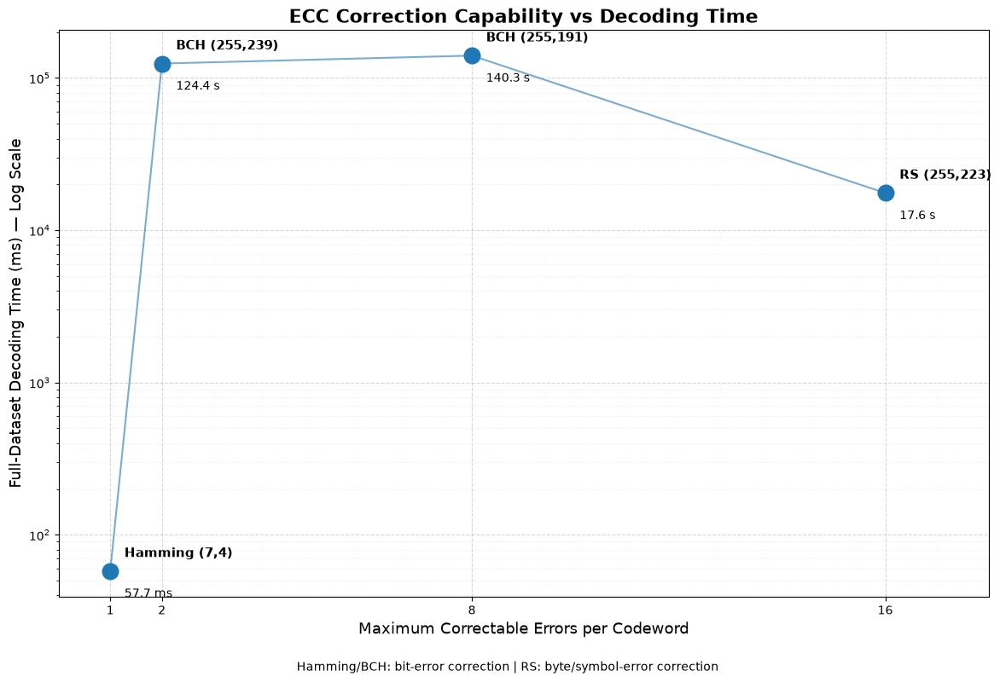
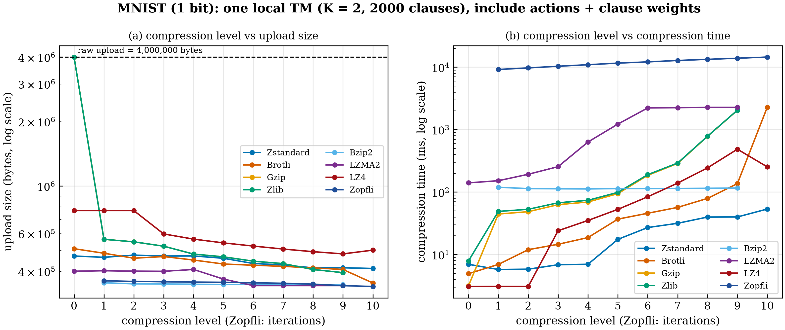
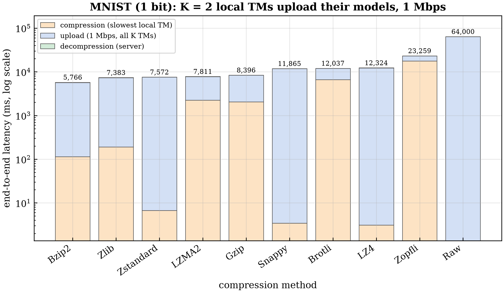
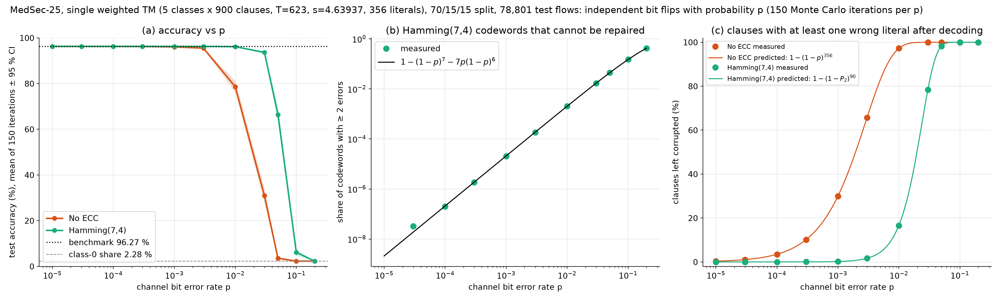
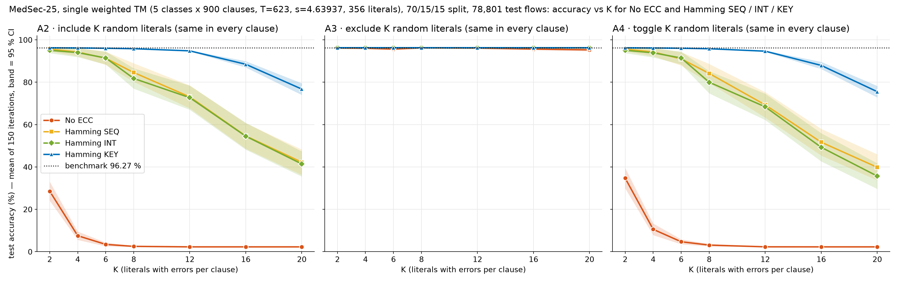

# Compression and error-correction experiments on Tsetlin Machine rule files

**Status:** Completed experiments (benchmarks and simulations); not deployed as a product
**Dates:** [?]
**Type:** Personal / research experiment, supporting `tm-ids-rpi-testbed`
**Evidence level overall:** [V] for numbers copied from CSVs and notebook outputs, [R] for my own statements, [?] where marked

Evidence levels: **[V]** = seen in a file or output in this folder, **[R]** = my own statement, **[?]** = not confirmed yet. Numbers were copied from the files, not re-run.

## 1. Problem and motivation
The rule file of a trained TM has to be sent to small devices, so it should be small (compression) and survive channel errors or a man-in-the-middle (error-correcting codes). These experiments compare representations, compressors and ECCs for size, speed and robustness. [V: `code/ecc/ecc_benchmark_iot/benchmark.py:1-9`]

## 2. Objectives and scope
- Goals: compare bit-packing and compressors; compare Hamming, BCH, Reed-Solomon, Polar, LDPC and convolutional coding for speed, overhead and robustness; test them against random bit errors and structured MITM-style attacks.
- **Not done (searched, nothing found):** line coding (NRZ-L, NRZ-I, Manchester and similar), own implementations of Huffman / LZ77 / LZ78 / LZW / arithmetic coding, quantisation, CRC, plain parity. Compression of network traffic was also not tested (only the TM rule files).

## 3. Hardware and software
| Item | Detail |
|---|---|
| Machine | x86 workspace, single thread ("like one Raspberry Pi core") - **not run on a Pi** [V: `benchmark.py:4-5`] |
| Data | Edge-IIoTset TM rules: 6 classes x 6000 clauses x 526 literals, 18.936 MB raw (1 byte per literal), 2.376 MB bit-packed; MedSec-25 rules for the attack simulations |
| Languages / libraries | Python, NumPy, numba, `galois` (BCH, RS), `ldpc`, `zstandard`, `brotli`, `lz4`, `snappy`, `zlib`, `bz2`, `lzma` |

## 4. Architecture and implementation
`rules.npy` -> bit-pack -> (compress) -> ECC encode -> corrupt (random BER or MITM-style literal attack) -> decode -> verify round trip / count residual errors -> TM accuracy. [INFERRED from `benchmark.py`, `attack_ecc.py`, `ecc_common.py`]

- `code/compression/` : notebook with the compression study, plus `clause_study_upload/` (upload-time study of compressed TMs: bench, plots, result tables).
- `code/ecc/error_coding.ipynb` : Hamming, BCH, Reed-Solomon, LDPC and convolutional codes with chosen error injections.
- `code/ecc/ecc_benchmark_iot/` : the "fair" re-benchmark (same machine, same data, single thread) and attack runs.
- `code/ecc/figures_sim/`, `code/ecc/medsciot/` : Monte Carlo simulation of Hamming layouts under attacks (150 iterations).

## 5. My specific contribution
- I did [R]: chose the experiments and **directed an AI assistant (Claude) to write all the code**.
- Written by the AI assistant under my instructions [R]: the scripts and notebooks in `code/`.
- **[?] to fill in:** what I ran, changed and interpreted myself. The notebook comments are informal ("above one didnt work and so im trying rle"), which suggests hands-on notebook use, but that does not establish who wrote the code.

## 6. Key technical decisions
| Decision | Alternatives | Why |
|---|---|---|
| Bit-pack first, then compress | compress the raw 1-byte-per-literal file | Packing alone gives 87 % reduction in 1.3 ms; compressing the packed data is smaller and faster than compressing raw [V] |
| Hamming(7,4) for the testbed | BCH, RS, Polar, LDPC | Fastest decode; weakest correction (1 bit per codeword) [V] |
| Re-benchmark in batch mode | per-codeword Python loop in the notebook | Notebook BCH decode 124 381 ms vs 636 ms in the fair re-benchmark [V: `table_notebook_reported_ecc.csv` vs `results_ecc.csv`] |

## 7. Challenges and debugging (from the files)
- "above we cant correct 2 codes in same code word": Hamming(7,4) fails when two errors fall in one codeword (notebook shows 3 mismatched bits) [V: `error_coding.ipynb`].
- RLE on the already-packed data came out larger (2.376 -> 8.026 MB) [V: `compression.ipynb` cell 18 output]; the markdown note before it reads "above one didnt work and so im trying rle" (cell 17) [V].
- Convolutional K=7 Viterbi decoding was interrupted as too slow [V: `table_notebook_reported_ecc.csv:6`].
- Notebook timings were 20-200x slower than the batch re-benchmark; the explanation (per-codeword loop vs batch) is inferred [INFERRED].

## 8. Results (verified only)
### Compression of the TM rule file (18.936 MB raw)
| Method | Size | Time | Evidence | Level |
|---|---|---|---|---|
| bit-packing (`np.packbits`) | 2.376 MB (-87.5 %) | 1.34 ms encode | `ecc_benchmark_iot/table_bitpacking_compression.csv` | [V] |
| zstd-1 on bit-packed | 0.753 MB | 8.6 ms total | same | [V] |
| bit-pack + XOR of consecutive rows + LZ4 | 1.263 MB (15.0x) | 7.1 ms | `compression.ipynb` cell 16 output | [V] |
| best ratio on raw: Brotli-11 | ratio 28.21 | slow | `compression.ipynb` cell 3 output | [V] |

Own implementations: bit-packing, COO / CSR / CSC, RLE, gap + varint, block-sparse, XOR-delta (all with round-trip checks). Library calls: zlib, gzip, bzip2, LZMA, zstd, Brotli, LZ4, Snappy, Zopfli. [V]

### Error-correcting codes (whole 19.0 Mbit rule file, one thread, x86)
| Code | (n, k, t) | Overhead | Encode | Decode (clean) | Evidence |
|---|---|---|---|---|---|
| Hamming(7,4) | (7, 4, 1 bit) | 75.0 % | 14.9 ms | 40.0 ms | `ecc_benchmark_iot/results_ecc.csv` [V] |
| BCH(255,239) | t = 2 bits | 6.7 % | 29.3 ms | 636 ms | same [V] |
| BCH(255,191) | t = 8 bits | 33.5 % | 67.6 ms | 1951 ms | same [V] |
| RS(255,223) | t = 16 bytes | 14.4 % | 75.8 ms | 391 ms | same [V] |
| Polar(256,224), SC | - | 14.3 % | 163 ms | 622 ms; 45 126 residual bit errors at BER 1e-3 | `results_total_time.csv:21` [V] |
| LDPC (`ldpc`, BP) | **parameters not recorded** | - | - | about 0.03 ms per run in notebook | `error_coding.ipynb` cell 33 [V] |

Hamming(7,4) under structured MITM-style attacks, layouts SEQ / INT / KEY, Monte Carlo: see the figures below [V].

## 9. Limitations and lessons learned
- All timings are on x86, not on a Raspberry Pi.
- Compression was tested on one file type (TM rules) only.
- Library compressors were used as black boxes; I did not implement Huffman, LZ or arithmetic coding myself.
- No line coding exists in this work, so no physical-layer claim can be made.
- Lesson: report times from the same machine and method. The notebook numbers and the re-benchmark differ by up to 200x.

## 10. Future improvements (suggestions, not claims)
Run the benchmarks on the Pi; add CRC-32 per datagram for detection; record the LDPC parameters; implement a line code only if a physical-layer experiment is planned.

## 11. Evidence and references
| Type | Location | What it proves |
|---|---|---|
| Notebooks | `code/compression/compression.ipynb`, `code/ecc/error_coding.ipynb` | the experiments and their outputs |
| Benchmark scripts and CSVs | `code/ecc/ecc_benchmark_iot/` | fair ECC and bit-packing numbers |
| Simulation scripts | `code/ecc/figures_sim/`, `code/ecc/medsciot/` | Monte Carlo attack simulation |
| Upload-time study | `code/compression/clause_study_upload/` | compression-level and upload-latency study |

## 12. Open questions (still to confirm)
- Where is the "NZ / NRZ coding" work (another machine, MATLAB, a report), or should it be dropped from the portfolio?
- LDPC code parameters (n, k).
- What did I run or change myself, and what was generated?
- Are the Edge-IIoTset and MedSec-25 derived files allowed to be published?

## 13. Interview prep
- **30 seconds:** I compared ways to shrink and protect a Tsetlin Machine rule file: bit-packing cut it by 87 %, and I benchmarked Hamming, BCH, Reed-Solomon and Polar codes for speed, overhead and robustness against random errors and targeted bit-flip attacks. An AI assistant wrote the code under my direction.
- **Hardest bug and how I solved it:** [fill in]
- **What would I do differently?** Run on the Pi and use a real MAC instead of ECC against attackers.

## Figures
| | |
|---|---|
|  |  |
|  |  |
|  |  |
|  |  |
|  |  |
