# Distributed Tsetlin Machine intrusion detection on a Raspberry Pi testbed, with a laptop acting as MITM

**Status:** Working testbed with measured runs (physical runs dated 2026-10-27 [V])
**Dates:** Oct 2026 [V for the runs]; start date [?]
**Type:** Personal / research experiment
**Evidence level overall:** [V] for the measurements listed in section 8, [R] for my own description of the setup, [?] where marked

Evidence levels: **[V]** = seen in a file or saved output in this folder, **[R]** = my own statement, not backed by a file here, **[?]** = not confirmed yet.

  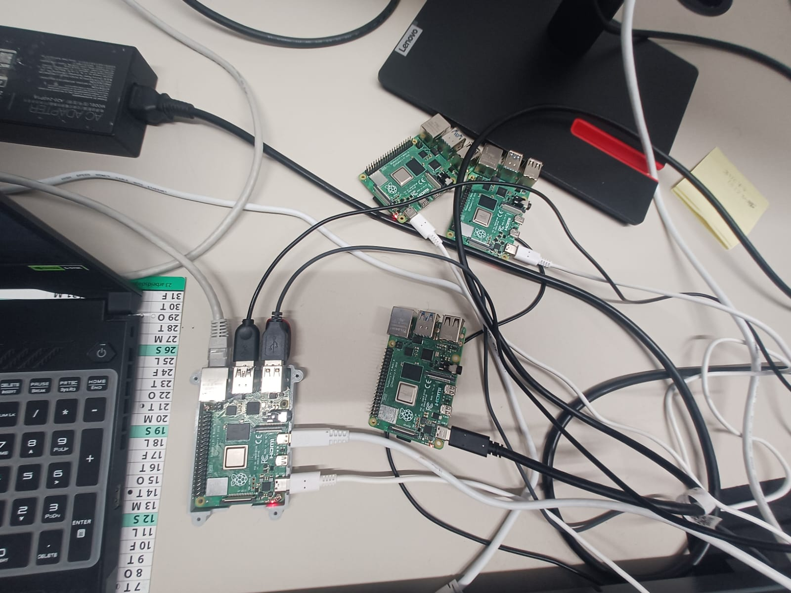
   The laptop (MITM) is connected by Ethernet to one sender Pi. More photos at the bottom of this page.

## 1. Problem and motivation
A trained Tsetlin Machine (TM) intrusion detector is split across several Raspberry Pis. Each sender Pi transmits its TM rules over UDP, protected by Hamming(7,4), to a central Pi that decodes, corrects and runs inference. The question: if a man-in-the-middle corrupts the packets of one sender, do error correction and fusion of several TMs keep the detector accurate? [V: `code/rpi_medsciot/README.md:1-4`, `code/rpi_3_c/README.md:1-12`]

## 2. Objectives and scope
- Goals: model a MITM on a real Pi network; measure how corrupted rules degrade one TM and the fused result; compare raw packets against Hamming(7,4); measure inference speed on the Pi (NEON, OpenMP).
- **Out of scope / not done:** ARP or DNS spoofing, any capture or attack on third-party traffic, Wi-Fi/router configuration code (not in the files), precision/recall/confusion matrix on the testbed, power and CPU measurements.

## 3. Hardware and software
| Item | Detail |
|---|---|
| Boards | 3 sender Raspberry Pis (one TM each) + 1 central Raspberry Pi + 1 laptop (the MITM) [V: `code/physical_rpi/README.md:8-13`] |
| Pi model | **[?] unresolved**: "Raspberry Pi 4" in `code/rpi_bench_infer/README.md:48` and the latency plot title, but a script header says Pi 5 (`power_monitor.py:1`, not copied) |
| OS / compiler | 64-bit Raspberry Pi OS, gcc [V: `code/rpi_bench_infer/README.md:48`] |
| Languages | C (sender, receiver, forwarder, NEON kernels), Python (training, relays, checks, plots) |
| Libraries | `tmu` for TM training, ARM NEON intrinsics, OpenMP, NumPy/Matplotlib |
| Transport | UDP, ports 5001 / 6000 [V: `code/rpi_medsciot/README.md:51`] |
| Dataset | MedSec-25, 5 classes (Benign, Exfiltration, Initial access, Lateral movement, Reconnaissance), 178 Boolean features -> 356 literals [V] |

## 4. Architecture and implementation

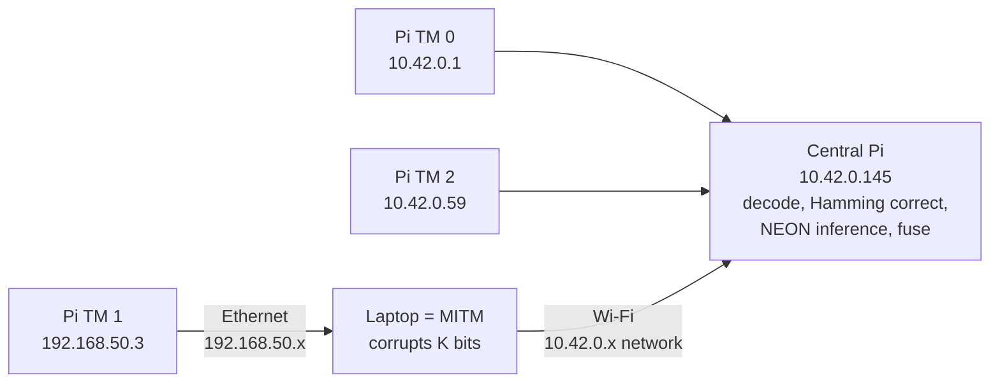
Addresses from `code/physical_rpi/README.md:10-13` [V]. Ethernet is photo-backed [V]; Wi-Fi is my own statement [R].

**Physical links:** the sender Pi whose traffic is attacked is connected to the **laptop by Ethernet** [V: photos `docs/evidence/ethernet_laptop_to_pi.jpg` and the walkthrough video show the cable from the laptop to that Pi], and the **laptop reaches the central Pi over Wi-Fi** [R: not visible in any file]. That Pi has no other route, so every packet of it has to pass through the laptop. What the files confirm: the laptop-facing link is a separate subnet (192.168.50.x) from the Pi network (10.42.0.x), and the older README says that Pi's "only route is through the laptop" (`code/rpi_medsciot/README.md:74`) [V]. The files do not record the laptop's own address on the central Pi's network [?]. Photo dates are [?]: the file names carry WhatsApp send dates (25 Sep, 30 Sep, 20 Oct 2026), not necessarily the capture dates.

**How the MITM is modelled [R, matches the code]:** one of the sender Pis has its traffic go through the laptop. The laptop corrupts the payload and forwards it to the central Pi, which receives it as if it came from that sender.

What the code shows exactly:
- **Final C testbed (`code/rpi_3_c`):** the sender is configured with the laptop as its destination (`sender.c:55-56`, `VIA_LAPTOP_NODE`), so that Pi *does* know the laptop address. The laptop's forwarder (`forwarder.c` / `forwarder.py`) is an ordinary UDP socket that receives, corrupts and re-sends. [V]
- **Earlier version (`code/rpi_medsciot`):** the Pi sends to the central IP and its only route is through the laptop, so it does not address the laptop at all (`README.md:74`). [V]
- **It is an application-level MITM.** The forwarder does not spoof IP addresses (no raw sockets in `forwarder.py`), so the central Pi sees the laptop's address as the source; the packet header carries the node number. [INFERRED from code]

Pipeline:
1. Train 3 TMs on MedSec-25 shards (5 classes x 900 clauses, 4-bit weights, 70/15/15 split) [V: `code/physical_rpi/README.md:3`].
2. Packetise 12 rules per packet, header with class / weight / sequence / node, Hamming(7,4) over payload and a protected header copy [V: `code/rpi_3_c/README.md:77-81`].
3. Relay and attack: include (force 1), exclude (force 0) or toggle K literal bits, or K random bits anywhere in the datagram [V: `code/rpi_3_c/forwarder.py`].
4. Receive: syndrome decode, correction, header checks, per-packet NEON inference, fusion = sum of the 3 TMs' class sums, then argmax [V: `code/rpi_3_c/receiver.c:55,84,145,316`].

**SIMD:** ARM NEON intrinsics are used in the Pi inference kernels and in the receiver (24 files); OpenMP in `tm09_interclause_omp.c` and `tm11_pipeline.c` [V]. The core kernel is `code/rpi_bench_infer/tm10_final_neon.c:76-99`. On x86 the NEON calls are mapped to SSE4.1 (`neon_compat.h`) for checking only.

### Two testbed versions (both physical, both 50 test flows)
| | First testbed (`code/rpi_medsciot`) | Final testbed (`code/rpi_3_c`, `code/physical_rpi`) |
|---|---|---|
| Central Pi | 10.42.0.59 | 10.42.0.145 |
| Senders | 10.42.0.1 and 10.42.0.82 direct; 192.168.50.3 behind the laptop (TM 2) | 10.42.0.1 and 10.42.0.59 direct; 192.168.50.3 behind the laptop (TM 1) |
| Sender addresses the laptop? | No: sends to the central IP, routed through the laptop | Yes: configured to send to the laptop (`VIA_LAPTOP_NODE`) |
| Model | deployed 3-TM MedSec-25 model (split into 3 packet streams) | 3 TMs, 5 x 900 clauses, 4-bit weights, 70/15/15 split |
| Attack | targeted: the K most-used literals, k = 2 (include / exclude / toggle) | blind: K random bits or literals, K swept 4 to 80+ |
| Clean accuracy (50 flows) | **86.0 %** | **82.0 %** |
| Source | `code/rpi_medsciot/results/rpi_runs_k2_summary.md` [V] | `code/physical_rpi/README.md` [V] |

The IP addresses were reassigned between the two versions (10.42.0.59 is the central Pi in the first and a sender in the final). The two accuracies come from different models, so they are not a before/after comparison. Whether the same 50 flows were used is [?].

## 5. My specific contribution
- I did [R]: designed the testbed concept (3 sender Pis, one central Pi, a laptop as MITM on one sender's route) and **directed an AI assistant (Claude) to write all of the code**.
- Written by the AI assistant under my instructions [R]: the C and Python code in `code/`. Several files describe themselves as reconstructions.
- **[?] to fill in honestly:** who built the network and ran the physical runs, and which parts I debugged or changed by hand.

## 6. Key technical decisions
| Decision | Alternatives considered | Why this choice |
|---|---|---|
| Hamming(7,4) on every packet | BCH, Reed-Solomon, Polar, LDPC (benchmarked in `compression-ecc-experiments`) | Fastest decode in the benchmark (40.0 ms vs 636 ms for BCH(255,239), x86, whole rule file) [V]; weakness: cannot repair 2 errors in one codeword |
| Fuse 3 TMs by summing class sums | Cap each TM at +-33 (earlier version) | One corrupted TM is outvoted [V: fused accuracy stays at 82% while TM 1 collapses] |
| C + NEON receiver | pure Python, NumPy | 5.24 ms vs 1979 ms for 256 flows on the Pi [V: `images/pi4_latency_per_method.png`] |

## 7. Challenges and debugging (from comments and results)
- Hamming(7,4) cannot repair two flipped bits in the same codeword; from K = 8 attacked literals TM 1 accuracy falls (84% -> 52% / 42%) [V: `code/physical_rpi/README.md:66-68`].
- If a corrupted bit lands in the clear header, all packets of that TM are dropped, so accuracy collapses without ECC [V: `images/testbed_blind_attacks_raw_vs_hamming.png`].
- Packets lost when senders transmit too fast; fix: raise `GAP_US` [V: `code/rpi_3_c/README.md:65`].
- Root causes beyond these [?].

## 8. Results (verified only; numbers copied from the files, not re-run)
| Metric | Value | How measured | Evidence | Level |
|---|---|---|---|---|
| Clean fused accuracy, physical testbed | 82.00 % (50 flows), 1198/1198 packets, 0 corrected codewords | physical run | `code/physical_rpi/README.md:15-25` | [V] |
| Central Pi processing time, 1198 packets | 11.49 + 4.19 + 6.89 = 22.57 ms (decode + ECC + inference) | timing CSV | `code/physical_rpi/clean_run_timing.csv` | [V] |
| Include attack on TM 1, K = 4 -> 30 | TM 1 84 % -> 42 %; fused stays 82 % | physical runs 6-12, 2026-10-27 | `images/testbed_accuracy_vs_K.png`, `code/physical_rpi/README.md:55-68` | [V] |
| Pi latency, 256 flows | pure Python 1979 ms -> C NEON + OpenMP (4 cores) 5.24 ms | benchmark on Pi | `images/pi4_latency_per_method.png`, `code/rpi_bench_infer/pi_results/` | [V] |
| Central receiver RAM | peak 1.39 MB | monitor | `images/central_rpi_ram_usage.png` | [V] |
| Simulated 3 distributed TMs, full test split | about 96 % fused, about 96 % single TM | simulation | `images/sim_accuracy_3tm.png` | [V] |
| **First testbed**, clean accuracy of the deployed 3-TM model | 86.0 % (50 flows) | reference run | `code/rpi_medsciot/results/rpi_runs_k2_summary.md` | [V] |
| **First testbed**, k = 2 targeted attack on the relayed Pi (TM 2), Hamming(7,4) | include / exclude / toggle: 50/50 decoded = reference, accuracy stays 86.0 % (PASS); corrected codewords 8842 / 1766 / 10608 | physical runs | `code/rpi_medsciot/results/rpi_runs_k2.csv` | [V] |
| First testbed, central Pi processing (1333 packets, one core) | about 20 ms decode + about 12 ms inference | physical runs | `code/rpi_medsciot/results/rpi_runs_k2_summary.md` | [V] |
| First testbed, larger k | from k = 4 literals share codewords and Hamming no longer repairs them; toggle k = 4 gave 64 % (32/50) on x86 localhost, **not measured on the Pis** | x86 localhost | `code/rpi_medsciot/README.md:105-110` | [V, x86 only] |

### Edge-IIoTset TM on the Pi (6 classes) - a separate result
Program: `code/iot_tm/rpi_customarchi.c` (6 classes, 6000 clauses per class, 526 literals, 50 input flows; the model is sent as 3 parts of 1000 UDP packets with Hamming(7,4)) [V: config at the top of the file]. This is the Edge-IIoTset model (which has a "MITM" traffic class), **not** the 5-class MedSec-25 model of the testbeds above [V].

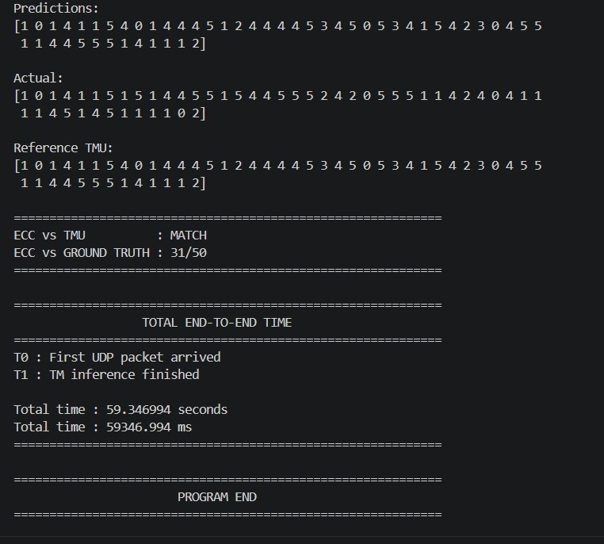

| Item | Value | Level |
|---|---|---|
| Pi predictions vs PC reference (TMU) | **MATCH** | [V: screenshot] |
| Accuracy vs ground truth, 50 flows | 31/50 (62 %); the PC reference model also reaches 31/50 (my statement) | [V screenshot] / [R] |
| Total time, first UDP packet to end of inference | 59.35 s | [V: screenshot] |

How to read it: the point is that the Pi decodes the ECC-protected packets and produces **exactly the PC's predictions**. The 62 % is the model's own accuracy on this 50-flow sample and says nothing about the Pi. The 59 s is probably dominated by sending the whole model over UDP, so it must not be compared with the 22 ms (MedSec testbed) or 5 ms (Pi benchmark) figures [INFERRED]. Date of the run, whether an attack was active, and the model's full-test accuracy are [?].

## 9. Limitations and lessons learned
- The testbed accuracy is on **50 flows, one seed per run** only. The same model scores about 96 % on the full test split, so the 82 % is a small-sample figure.
- Only accuracy was measured on the testbed: no precision, recall, false-positive rate or confusion matrix.
- The "attack" is a cooperative relay on my own network that edits UDP payloads. It is not ARP/DNS spoofing.
- Hamming(7,4) repairs random-looking errors but not a deliberate attacker; targeted multi-bit changes defeat it. A per-packet MAC/HMAC would be the real fix.
- The network setup (how the laptop ended up in the path) is not in the files, so the testbed cannot be rebuilt from this folder alone.

## 10. Future improvements (suggestions, not claims)
Commit the network configuration and a topology diagram; add a packet authentication code; report precision/recall on the full test split; run the ECC benchmarks on the Pi itself.

## 11. Evidence and references
| Type | Location | What it proves |
|---|---|---|
| Code (testbed) | `code/rpi_3_c/`, `code/rpi_medsciot/` | sender, receiver, forwarder (the MITM), checks |
| Code (Pi kernels) | `code/rpi_bench_infer/`, `code/rpi_codes_benchmark/` | 10 inference variants incl. NEON and OpenMP |
| Code (training / simulation) | `code/medsec_tm_training/`, `code/rpi_dist3_infer/` | TM training and error injection |
| Measured data | `code/physical_rpi/*.csv`, `code/rpi_bench_infer/pi_results/` | testbed runs and Pi benchmark |
| Figures | `images/` | plots of the above |
| Photos | `docs/evidence/ethernet_laptop_to_pi.jpg`, `four_pis_and_hub.jpg`, `bringup_note_and_hello_test.jpg` | 4 Raspberry Pis, the laptop, the Ethernet cable to the relayed Pi, and an early "HELLO FROM RPI" connectivity test with the handwritten plan |
| Video | `docs/evidence/testbed_walkthrough.mp4` (20 s, handheld, audio removed) | the desk setup and the receiver terminal (445/445, 446/446, 442/442 packets, 7983 corrected codewords on TM 2, decoded vs reference 49/50; the accuracy digits are too blurry to read) |
| Terminal screenshot | `docs/evidence/iot_tm_pi_run_terminal.jpg` | the 6-class run above |
| Not included | raw datasets, trained model binaries, packet captures, large notebooks | size / licence unknown |

## 12. Open questions (still to confirm)
- Which Raspberry Pi model (4, 5, or both)?
- Was the network isolated (only my own devices)?
- Both results are now shown (86 % first testbed, 82 % final testbed). Which model each used for the same 50 flows, and why the model changed between them, is [?].
- Which parts did I personally run, debug or change?
- Are MedSec-25 / Edge-IIoTset derived data allowed to be published?

## 13. Interview prep
- **30 seconds:** I built a Raspberry Pi testbed where three Pis send Tsetlin Machine rules over UDP with Hamming error correction to a central Pi, and a laptop in one Pi's path corrupts its packets. I measured how much a corrupted TM hurts accuracy with and without ECC, and optimised the central Pi's inference with NEON and OpenMP. An AI assistant wrote the code under my direction.
- **Hardest bug and how I solved it:** [fill in with something I actually hit]
- **What would I do differently?** Add authentication instead of relying on ECC against a deliberate attacker, and test on far more than 50 flows.

## Figures
| | |
|---|---|
| 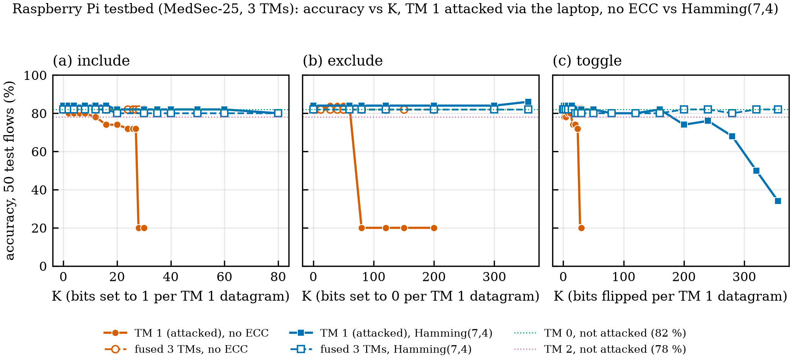 | 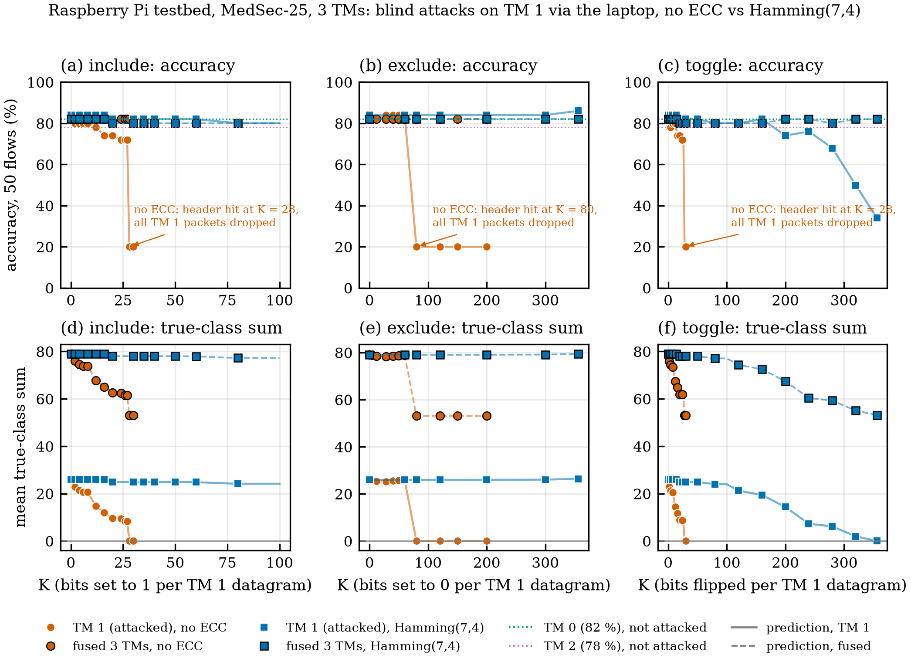 |
| 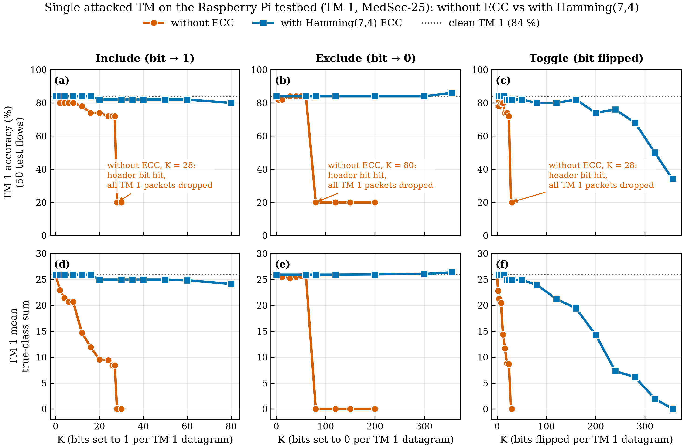 | 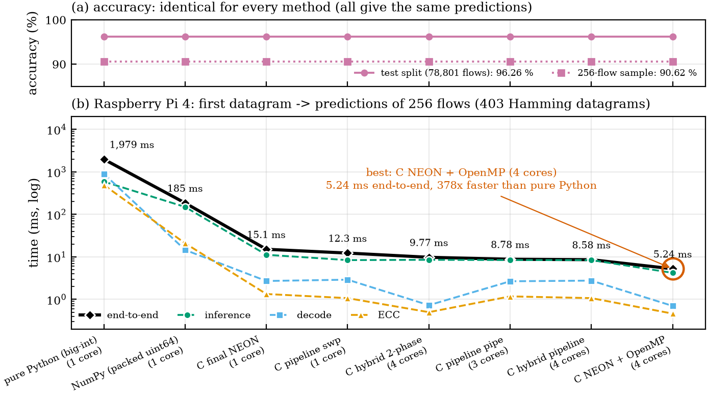 |
| 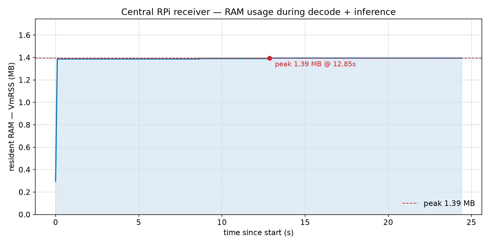 | 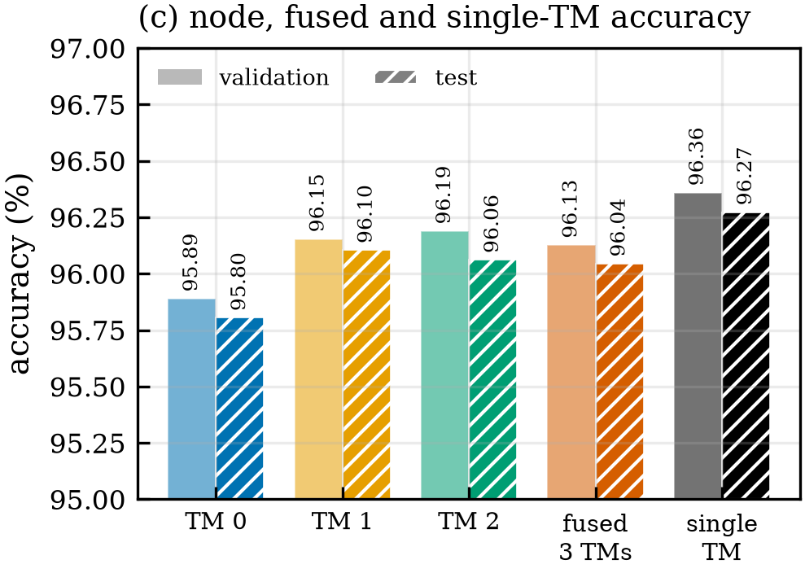 |
| 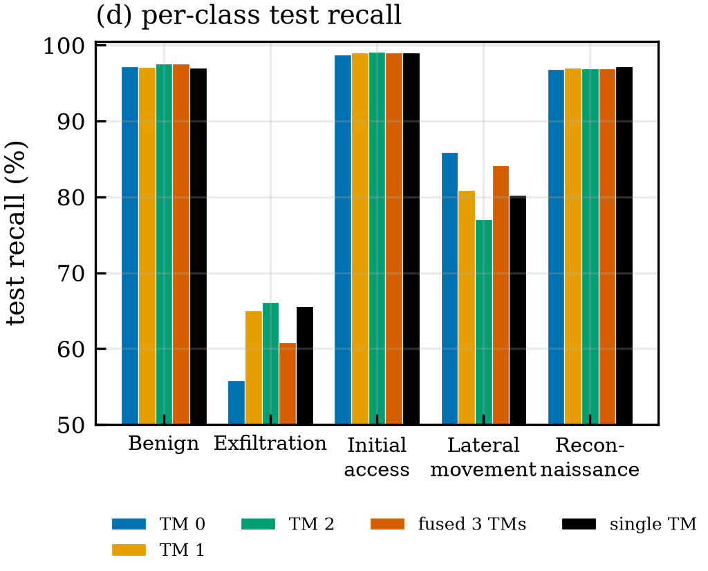 | 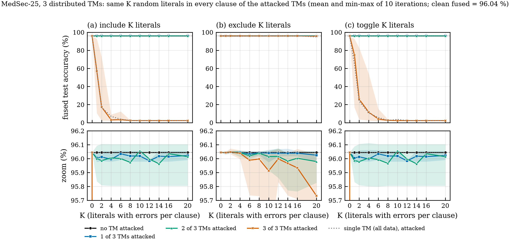 |

## Photos of the setup
| | | |
|---|---|---|
|  | 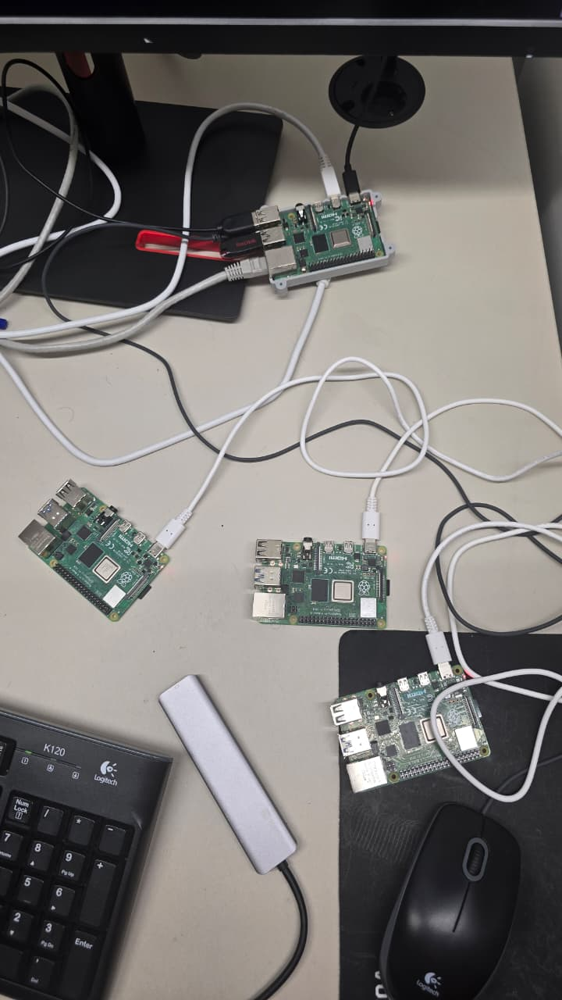 | 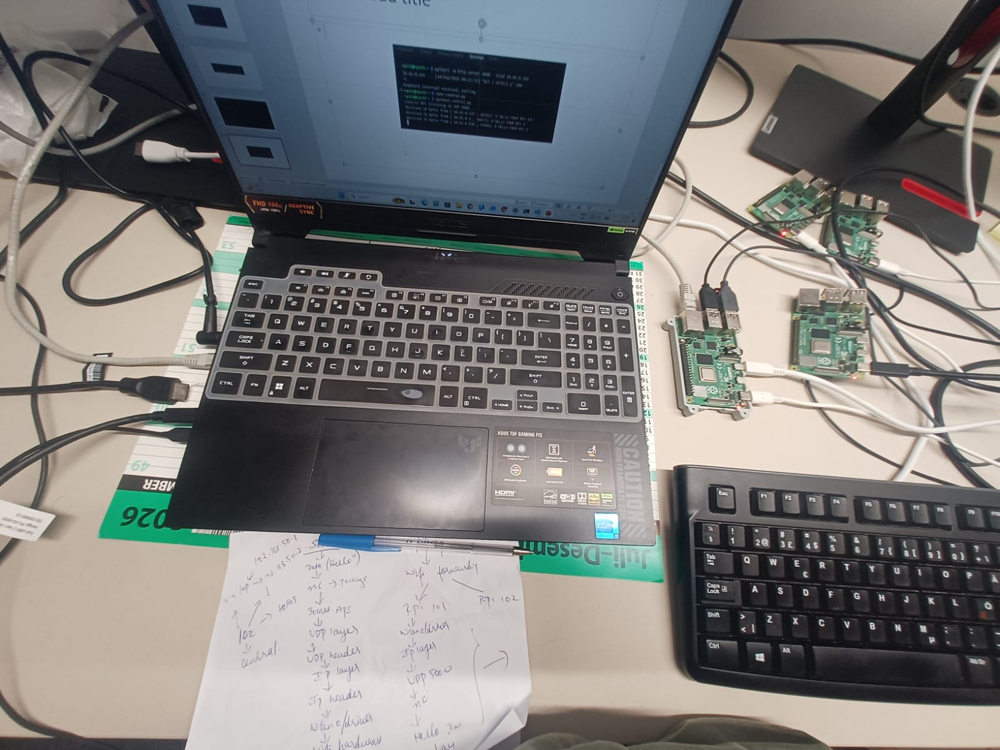 |
| Laptop (left) with an Ethernet cable to the Pi in the grey case | Four Raspberry Pis and a USB hub | Handwritten plan and the first "HELLO FROM RPI" UDP test |

Video: [`docs/evidence/testbed_walkthrough.mp4`](docs/evidence/testbed_walkthrough.mp4) (handheld pan, about 20 s). The terminal text is partly blurry.
